# InviteIZI: визуальное разнообразие 50 дизайнов — 29.10.2026

Это сравнительный аудит и план для согласования. Компоненты дизайнов, активность каталога, цены и клиентские ссылки не изменены. Проверены все 50 **активных** локальных демо текущего HEAD; скрытый anor-bogi не включён. Рабочая Supabase и production не использовались.

## Как проверялось и где доказательства

Chromium, мобильный viewport 375×812, обычное движение: просмотр заставки, реальный клик открытия Animated, прокрутка всей страницы, первый экран после открытия и программа мероприятий. Сопоставлялись композиция, позиции имён и даты, порядок и форма блоков программы, декор, открытие и последовательность прокрутки. Выводы основаны на просмотре всех 10 листов; полные страницы сохранены для дополнительной проверки, а не названиях. Различные демоданные не считаются отличием дизайна.

Все 50 страниц вернули 200, все 23 Animated открылись; горизонтального переполнения и ошибок pageerror в завершённых проверках нет. Три первоначальные ошибки Next dev router во время HMR исчезли в повторе; первоначальные результаты сохранены в `priorAttempts` inventory.json. Число `events` там отражает только атрибуты data-event: у старых компонентов другие атрибуты, ноль не означает отсутствие мероприятий.

**Ограничение:** Google Fonts заблокированы сетью среды, поэтому часть next/font/google показана запасным шрифтом dev-режима. Локальные шрифты и изображения настоящие. Это позволяет оценить композицию, но не даёт окончательной приёмки типографики или соответствия production пиксель в пиксель. Проверки 320/430 px и слабого физического телефона в этот аудит не входили. Перед переработкой нужно повторить типографику после открытия доступа к fonts.googleapis.com и fonts.gstatic.com.

[Машиночитаемый инвентарь](inventory.json). Ниже 10 листов по пять дизайнов: верхняя строка — заставка (для Simple/Scroll начальная анимация входа), средняя — открытый первый экран, нижняя — программа, вырезанная из полной страницы. Для одностраничных дизайнов повтор кадра ожидаем. Полные страницы каждого дизайна связаны в таблице покрытия.

## Главные группы сходства и предложения

Сходство здесь означает повтор композиционного каркаса; это не утверждение, что компоненты полностью одинаковы. Разное открытие само по себе не устраняет сходство открытого приглашения. P1 — сначала показать владельцу эскиз новой композиции; P2 — следующая очередь, если эта группа мешает выбору; «сохранить» — убедительного повода менять композицию в этом сравнении нет.

### A — центрированные Animated: №94, 96, 104, 105 (P1)

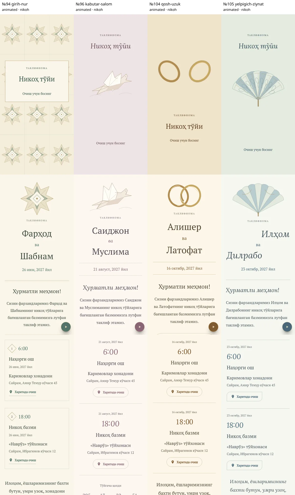

Декор и открытие различаются (гирих, птица, кольца, веер), но открытые экраны повторяют вертикаль «объект → имена друг под другом → дата → приглашение», а программа — время, название и адрес на центральной оси. Особенно близки №104 и №105. №91 имеет похожий каркас, но заметную ось программы; №100 отличается левым выравниванием. Они P2, не точные повторы этой четвёрки.

Предложение: оставить №104 как центральный вариант. Для **№105** перенести веер с верхней эмблемы в боковую раскрытую композицию, расположить имена двумя смещёнными строками на широких бумажных секциях, дату — отдельной полосой между ними. Мероприятия оформить как последовательные складки листа с чередующимся расположением времени и широким адресом, сохранив читаемость в одной колонке. Для **№96** сделать открытое письмо: дата в верхнем штампе, обращение раньше имён, имена как две подписи внизу первого листа, программа — второй лист. №94 пока сохранить до сравнения двух эскизов; при необходимости — имена в противоположных углах геометрической сетки и дата в её центре.

### B — широкое фото и центральные имена: №65, 66; сравнение с №69, 83

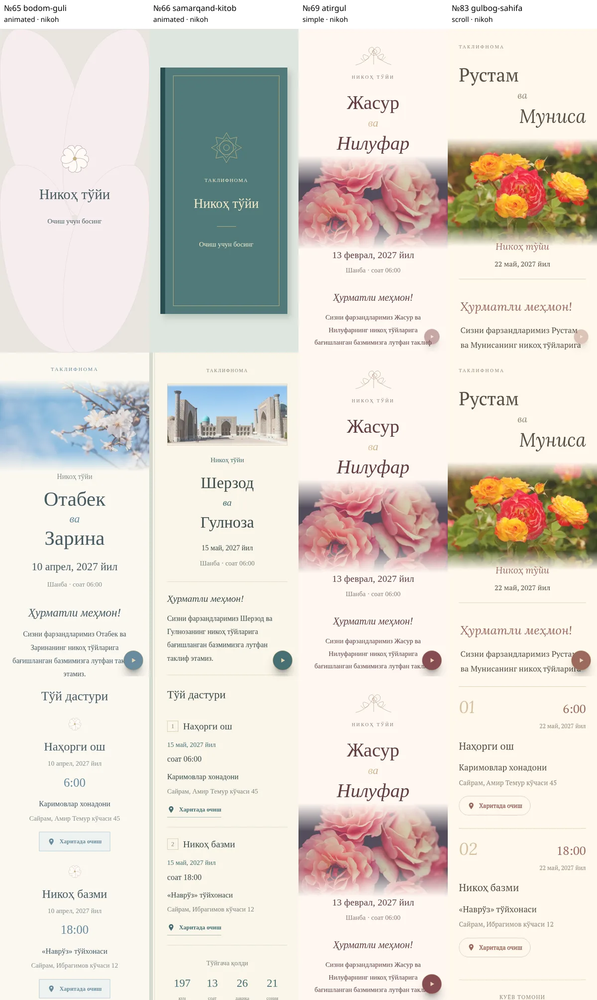

№65 и №66 после эффектного открытия имеют близкий порядок: фото во всю ширину, два центральных имени, дата и текст, затем вертикальная программа. №69 уже меняет порядок (роза под именами), №83 — выравнивание и нумерацию программы; они P2, не одинаковые композиции. Форматы различаются: 65/66 Animated, 69 Simple, 83 Scroll. Сравнение касается открытой страницы, не обещания формата.

P1: переработать **№66**, сохранив №65 как цветочную открытку. Книга должна оставаться частью композиции после открытия: единая полоса имён на титульном листе, дата как крупная закладка у края, программа как пронумерованные главы с разными вводными полосами, семьи — две колонки внутри одного широкого разворота, на 320 px последовательно. Не заменять только фотографию или оттенок.

### C — диагональные имена и знакомая нижняя часть: №93, 97, 102; сравнение с №101

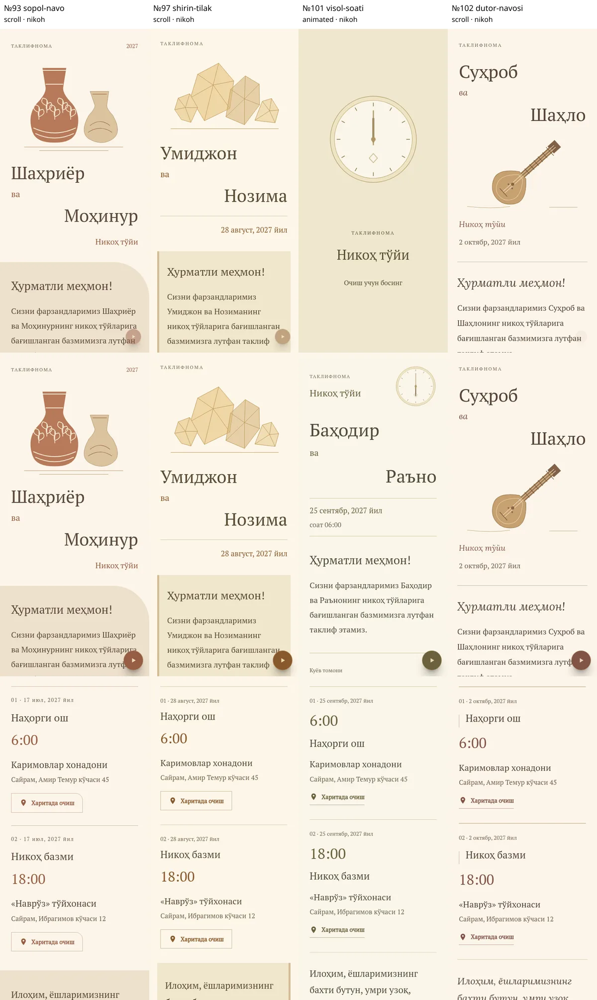

В трёх Scroll №93/97/102 повторяются два разнесённых имени, иллюстрация, текстовая вставка и практически одинаковый порядок нумерованной программы с крупным временем. У №101 Animated часы и заставка свои, но открытый каркас родственен. №82 Simple компактнее и без длинного пути; включать его в ту же переработку не нужно.

P1: оставить №93 как керамический вариант. Для **№102** сделать дутар не отдельной картинкой между блоками, а боковой осью страницы: имена в одном широком заголовке, дата в круглом акценте у корпуса инструмента, события как два самостоятельных широких «куплета» с разным положением времени. Для №97 P2: сладости внизу титула, дата крупной плашкой сверху, программу объединить в один общий лист с колонкой времени. Ни одно из этих изменений пока не реализовано.

### D — архитектурные рамки: №61, 62, 68, 70 (P2)

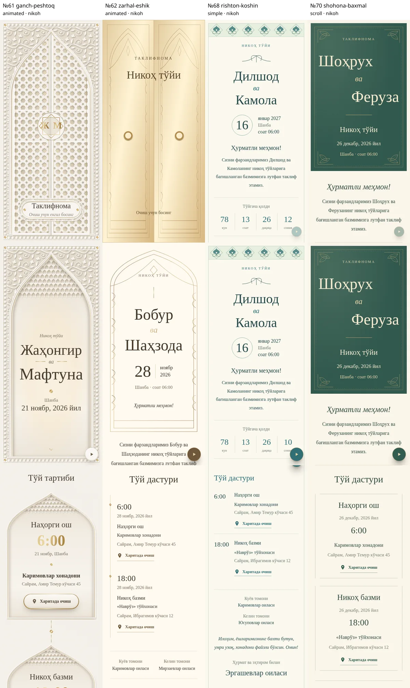

Все имеют центральную пару имён, рамку/арку, дату ниже и последовательные мероприятия. При этом №61 заметно самостоятельнее: высокая ганчeвая арка продолжается вокруг карточек, есть календарь и длинные разделы. №62 отличается дверями и большим днём, №68 — кругом даты и короткой подачей, №70 — отдельным тёмным титульным прямоугольником. Это семейство, а не четыре одинаковых шаблона.

Если нужно усилить различие, менять **№62**: перенести день на верхнюю перемычку дверного проёма, имена расположить по двум сторонам общего соединяющего элемента; программу сделать как путь через два проёма, а не обычную линию. №61/68/70 пока сохранить. Не менять все рамки одновременно.

### E — компактные Simple для Наҳорги ош: №77, 85, 89 (P2)

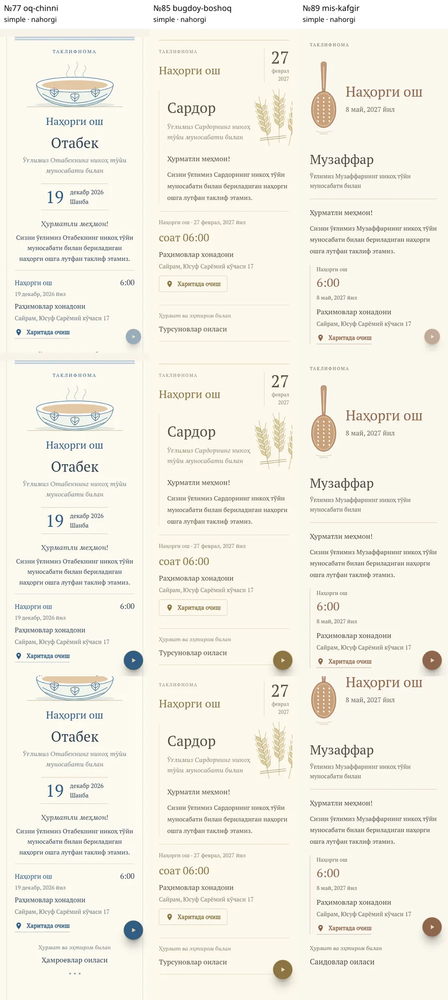

Одинаковая плотность и состав данных, но уже есть различия: №77 центрирован с пиалой, №85 имеет дату справа и колосья, №89 — капгир у заголовка и линию адреса. Называть их дубликатами неверно; риск — одинаковая последовательность «заголовок/имя → обращение → место».

При необходимости переработать только **№89**: вывести время и место в первый смысловой блок, имя хозяина поместить в нижнюю подпись рядом с капгиром, дату интегрировать в верхнюю тонкую полосу. Сохранить компактность Simple и читаемый адрес. №77/85 сохранить как контрольные варианты.

## Что согласовать перед изменением шаблонов

Предлагаемая первая партия — только **№105, №96, №66, №102**. Сначала по одному статическому эскизу открытого первого экрана и программы для каждого, рядом с нынешним вариантом. Владелец выбирает конкретные композиции; затем отдельная реализация и проверка 320/375/430 px, длинных имён, 1–3 мероприятий, открытия и прокрутки. Идентификаторы, старые ссылки, цены и сохранённые суммы/форматы заказов не менять. Если необходимо сохранить вид уже оплаченных ссылок при будущей смене компонента, сначала отдельно согласовать стратегию версий: сейчас старые ссылки используют тот же движок.

P2 не включать в первую партию автоматически. Изменений цветов или скорости анимации недостаточно для приёмки новой композиции. Новые дизайны и включение anor-bogi не предлагаются.

## Полное покрытие — 50 из 50

| № | Дизайн / полный скриншот | Формат | Наблюдение и решение |
|---|---|---|---|
| 1 | [Олтин монограмма · oltin-monogramma](full/oltin-monogramma.webp) | animated | Монограмма в венке, имена ниже; отдельный календарь, объёмные карточки программы. Сохранить. |
| 23 | [Сапфир · sapfir](full/sapfir.webp) | simple | Тёмная одностраничная рамка: имена, дата и адрес внутри одного экрана. Сохранить. |
| 31 | [Оқ от · oq-ot](full/oq-ot.webp) | animated | Синий занавес, крупное имя, архитектурный низ; программа в отдельном блоке. Сохранить. |
| 41 | [Тонгги қозон · tonggi-qozon](full/tonggi-qozon.webp) | animated | Рассвет и большой казан, время как самостоятельный акцент; адрес отдельной карточкой. Сохранить. |
| 51 | [Пион гулдаста · pion-guldasta](full/pion-guldasta.webp) | animated | Юбилейная цифра и ваза с пионами, затем адрес. Отличается от №80/81/86/87. |
| 61 | [Ганч пештоқ · ganch-peshtoq](full/ganch-peshtoq.webp) | animated | Высокая ганчeвая арка обрамляет имена и каждое мероприятие. Группа D, P2. |
| 62 | [Зарҳал эшик · zarhal-eshik](full/zarhal-eshik.webp) | animated | Двери → имена в арке → крупный день → линейная программа. Группа D, P2. |
| 63 | [Атлас тўлқини · atlas-tolqin](full/atlas-tolqin.webp) | animated | Имена слева, атласная полоса вдоль края, угловые карточки программы. Выраженная асимметрия. |
| 65 | [Бодом гули · bodom-guli](full/bodom-guli.webp) | animated | Широкая фотография сверху, имена по центру, дата и текст ниже. Группа B, P1. |
| 66 | [Самарқанд · samarqand-kitob](full/samarqand-kitob.webp) | animated | Обложка книги отличается; после открытия фото и имена повторяют центральную схему №65. Группа B, P1. |
| 67 | [Ипак рўмол · ipak-romol](full/ipak-romol.webp) | simple | Компактная тканевая композиция с венком, двумя семьями и расписанием внутри одного полотна. Сохранить. |
| 68 | [Риштон кошин · rishton-koshin](full/rishton-koshin.webp) | simple | Кошинный верх, имена по центру, круглый день рядом с месяцем; программа списком. Группа D, P2. |
| 69 | [Атиргул · atirgul](full/atirgul.webp) | simple | Имена над широкой розой, дата под ней; уже меняет порядок относительно №65/66. Группа B, P2. |
| 70 | [Шоҳона бахмал · shohona-baxmal](full/shohona-baxmal.webp) | scroll | Зелёный прямоугольный титул, имена по центру; ниже однотипные рамки мероприятий. Группа D, P2. |
| 71 | [Тандир нури · tandir-nuri](full/tandir-nuri.webp) | animated | Круг тандыра при открытии; время 6:00 доминирует над фото хлеба. Сохранить. |
| 72 | [Дастурхон · dasturxon](full/dasturxon.webp) | animated | Узорная заставка, центрированный заголовок и плов, время под фото; пунктирный край программы. Сохранить. |
| 73 | [Нон муҳри · non-muhr](full/non-muhr.webp) | animated | Круглая хлебная печать превращается в дату; имя и программа на одной центральной оси. Сохранить. |
| 74 | [Тонгги чой · tonggi-choy](full/tonggi-choy.webp) | scroll | Круглая фотография чая, затем левый заголовок и имя; компактная строка времени/мероприятия. Сохранить. |
| 75 | [Пахта гул · paxta-gul](full/paxta-gul.webp) | scroll | Хлопковая ветвь, центрированное имя, день в строке; арочная карточка события. Сохранить. |
| 76 | [Олтин от · oltin-ot](full/oltin-ot.webp) | animated | Подарочная коробка → золотой конь в медальоне → имя; программа с вертикальной осью. Сохранить. |
| 77 | [Оқ чинни · oq-chinni](full/oq-chinni.webp) | simple | Пиала, имя и день по центру; компактное мероприятие внизу. Группа E, P2. |
| 78 | [Дўппича · doppicha](full/doppicha.webp) | simple | Тюбетейка и имя по центру, два мероприятия в компактных карточках. Отличается от левого №88. |
| 79 | [Сайрам ҳовлиси · sayram-hovli](full/sayram-hovli.webp) | scroll | Имя над изображением двора, дата ниже, затем расписание по вертикали. Сохранить. |
| 80 | [Зарварақ · zarvaraq](full/zarvaraq.webp) | simple | Возраст в венке, имя и компактный адрес в одной памятной карточке. Сохранить. |
| 81 | [Умр дарахти · umr-daraxti](full/umr-daraxti.webp) | scroll | Дерево с возрастом, имя под деревом; текст с боковой линией, нумерованный адрес ниже. Сохранить. |
| 82 | [Марварид сатри · marvarid-satr](full/marvarid-satr.webp) | simple | Имена диагональю под жемчужной дугой; плотные строки событий. Сравнить с группой C, P2. |
| 83 | [Гулбоғ саҳифаси · gulbog-sahifa](full/gulbog-sahifa.webp) | scroll | Имена диагональю над широким садовым фото; нумерованные события с временем справа. Группа B, P2. |
| 84 | [Сўзана йўли · suzani-yol](full/suzani-yol.webp) | scroll | Широкий вышитый цветочный пояс, имена по центру; цветные шапки событий с временем справа. Сохранить. |
| 85 | [Буғдой бошоғи · bugdoy-boshoq](full/bugdoy-boshoq.webp) | simple | День в правом верхнем углу, имя слева, колосья справа; компактный адрес ниже. Группа E, P2. |
| 86 | [Лола эҳтироми · lola-ehtirom](full/lola-ehtirom.webp) | scroll | Тюльпан слева, возраст справа; имя под иллюстрацией; отдельная рамка программы. Сохранить. |
| 87 | [Зарҳал лавҳа · zarhal-lavha](full/zarhal-lavha.webp) | animated | Открытие золотой лавхи; возраст в узкой левой колонке, имя справа, нумерованная программа. Сохранить. |
| 88 | [Адрас нишони · adras-nishon](full/adras-nishon.webp) | simple | Адрасный знак слева от заголовка, имя слева; дата отдельной узкой колонкой рядом с событием. Сохранить. |
| 89 | [Мис капгир · mis-kafgir](full/mis-kafgir.webp) | simple | Капгир слева от заголовка, имя и текст ниже; вертикальная линия адреса. Группа E, P2. |
| 90 | [Райҳон саҳари · rayhon-sahari](full/rayhon-sahari.webp) | scroll | Диагональная ветвь райхона, заголовок в две строки, имя ниже; программа на отдельном цветном листе. Сохранить. |
| 91 | [Висол риштаси · visol-rishta](full/visol-rishta.webp) | animated | Ленты связываются при открытии, затем узел над центральной парой имён; программа на вертикальной оси. Родство с A, P2. |
| 92 | [Узум ҳовлиси · uzum-hovli](full/uzum-hovli.webp) | scroll | Виноградная пергола над центральной парой имён; мероприятия в прямоугольных рамках. Сохранить, следить за родством с A. |
| 93 | [Сопол навоси · sopol-navo](full/sopol-navo.webp) | scroll | Два кувшина над диагональной парой имён; затем текст и обычные нумерованные события. Группа C, P1. |
| 94 | [Гиреҳ нури · girih-nur](full/girih-nur.webp) | animated | Гирих-заставка и звезда сверху; дальше центральные имена, дата и линейные события. Группа A, P1. |
| 95 | [Сиёҳ дуоси · siyoh-duo](full/siyoh-duo.webp) | animated | Каллиграфический росчерк, имена слева, дата справа; программа с номерами и подчёркиваниями. Сохранить. |
| 96 | [Кабутар саломи · kabutar-salom](full/kabutar-salom.webp) | animated | Бумажная птица при открытии и над именами; центральная пара, дата и список программы. Группа A, P1. |
| 97 | [Ширин тилак · shirin-tilak](full/shirin-tilak.webp) | scroll | Сладости сверху, имена диагональю, дата справа; цветная вставка текста и линейная программа. Группа C, P1. |
| 98 | [Минор сатри · minor-satr](full/minor-satr.webp) | scroll | Минарет слева от шапки, оба имени на левой оси; нумерованные события без карточек. Сохранить. |
| 99 | [Кумуш тароқ · kumush-taroq](full/kumush-taroq.webp) | scroll | Гребень над центральными именами, текст в арочной рамке; день каждого события в круге. Сохранить. |
| 100 | [Шабнам висоли · shabnam-visol](full/shabnam-visol.webp) | animated | Капля при открытии, ветвь над левыми именами; события на общем цветном полотне. Родство с A слабее, P2. |
| 101 | [Висол соати · visol-soati](full/visol-soati.webp) | animated | Часы справа сверху, имена диагональю, дата полосой; та же последовательность текста и программы. Группа C, P2. |
| 102 | [Дутор навоси · dutor-navosi](full/dutor-navosi.webp) | scroll | Имена диагональю над дутаром, дата под ним; программа с номерами и временем. Группа C, P1. |
| 103 | [Тут қоғози · tut-qogozi](full/tut-qogozi.webp) | scroll | Имена и дата на листе тутовой бумаги; ниже отдельные разделы, программа нумерованными строками. Сохранить. |
| 104 | [Қўш узук · qosh-uzuk](full/qosh-uzuk.webp) | animated | Два кольца соединяются, затем кольца над центральными именами; дата и центральная программа. Группа A, P1. |
| 105 | [Елпиғич зийнати · yelpigich-ziynat](full/yelpigich-ziynat.webp) | animated | Раскрывающийся веер, затем веер над центральными именами; дата и почти тот же порядок блоков, что №104. Группа A, P1. |
| 106 | [Саодат калити · saodat-kaliti](full/saodat-kaliti.webp) | animated | Ключ открывает замок; ключ в шапке над левыми именами; текст с боковой линией и программа слева. Сохранить. |

## Все сравнительные листы

### Лист 1

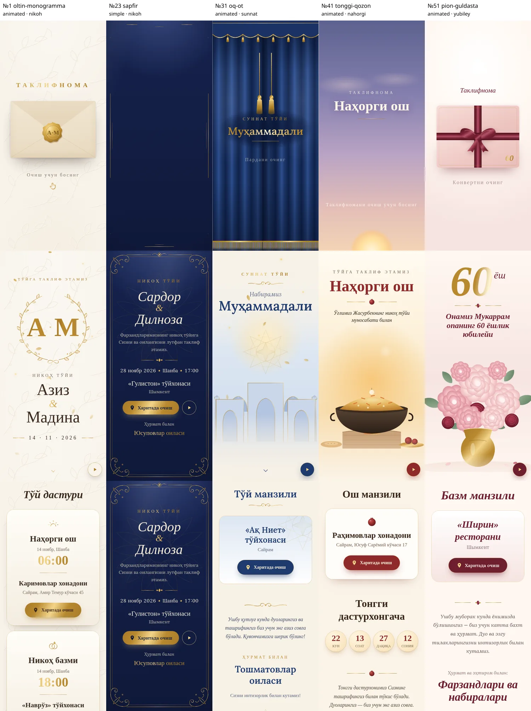

### Лист 2

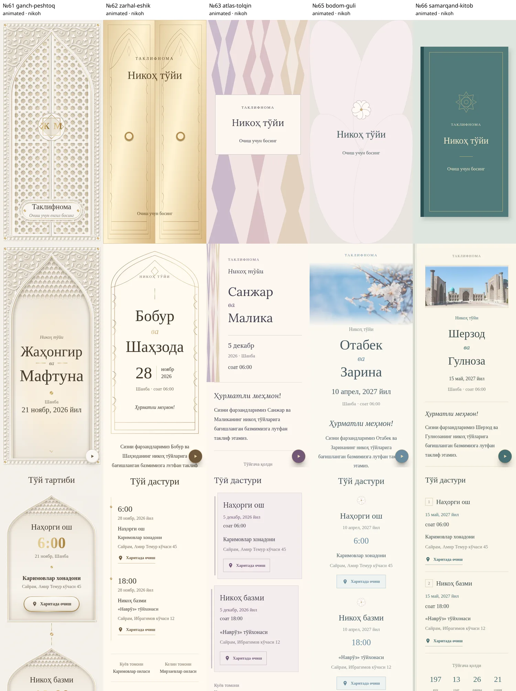

### Лист 3

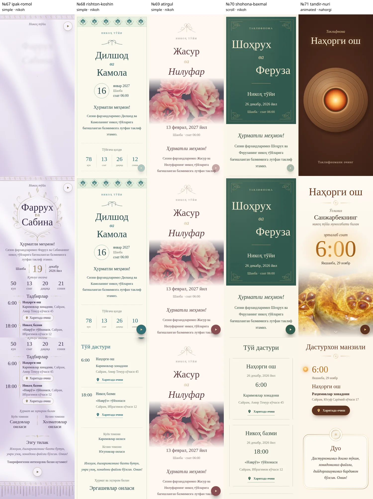

### Лист 4

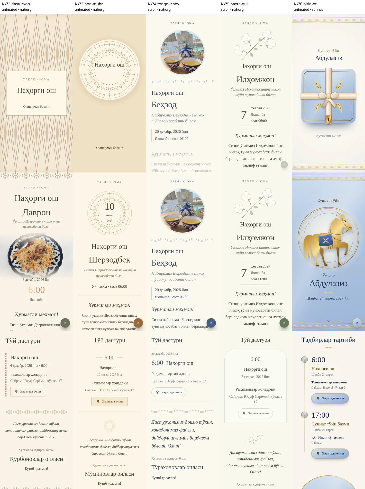

### Лист 5

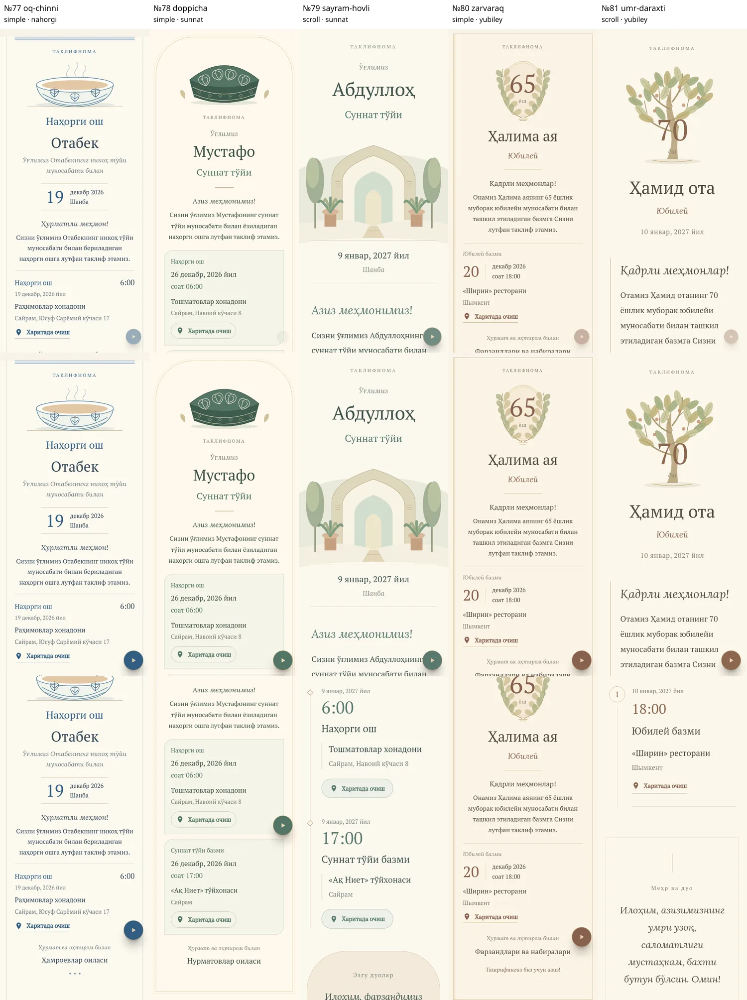

### Лист 6

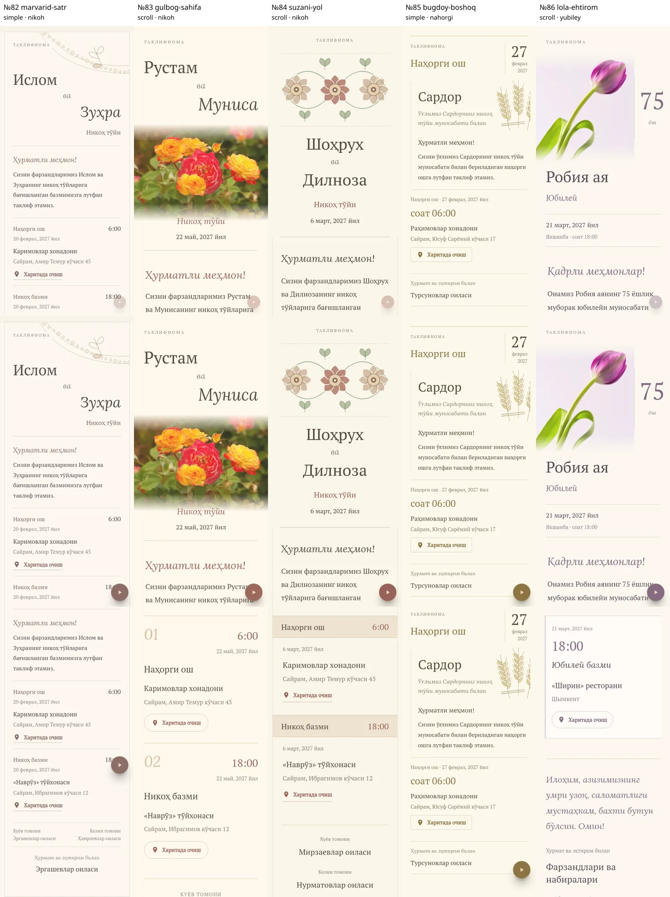

### Лист 7

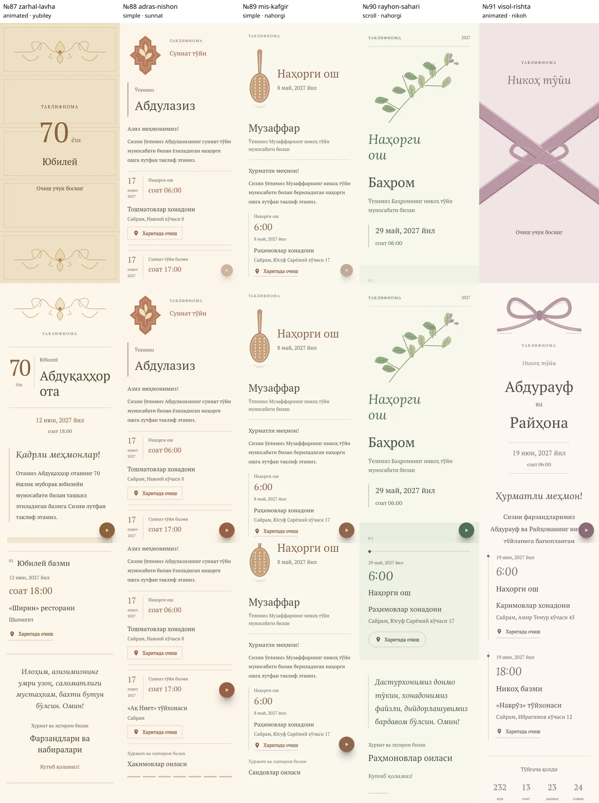

### Лист 8

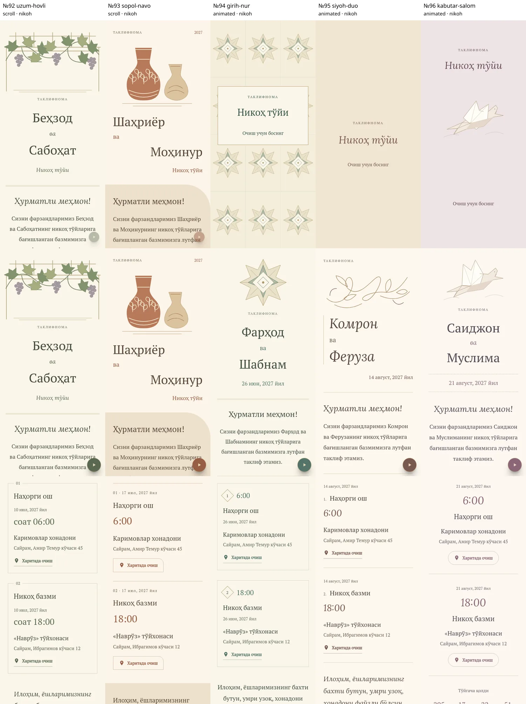

### Лист 9

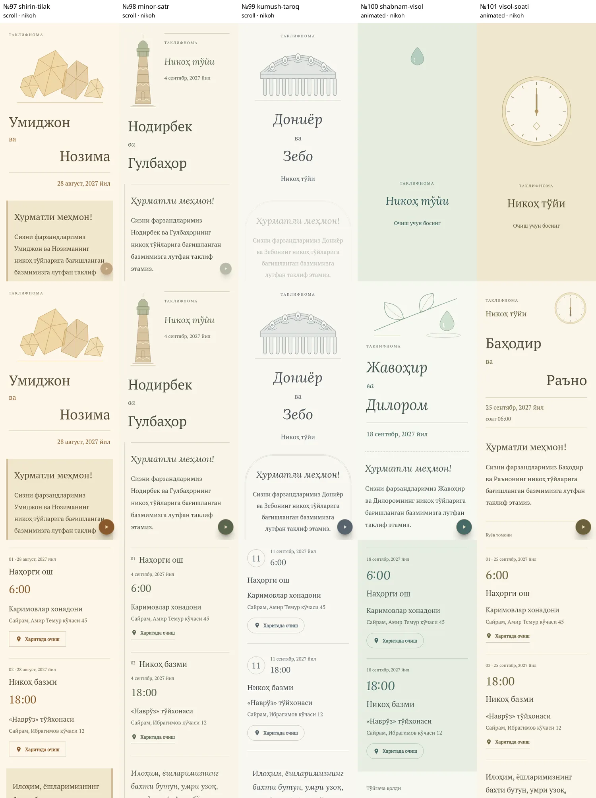

### Лист 10

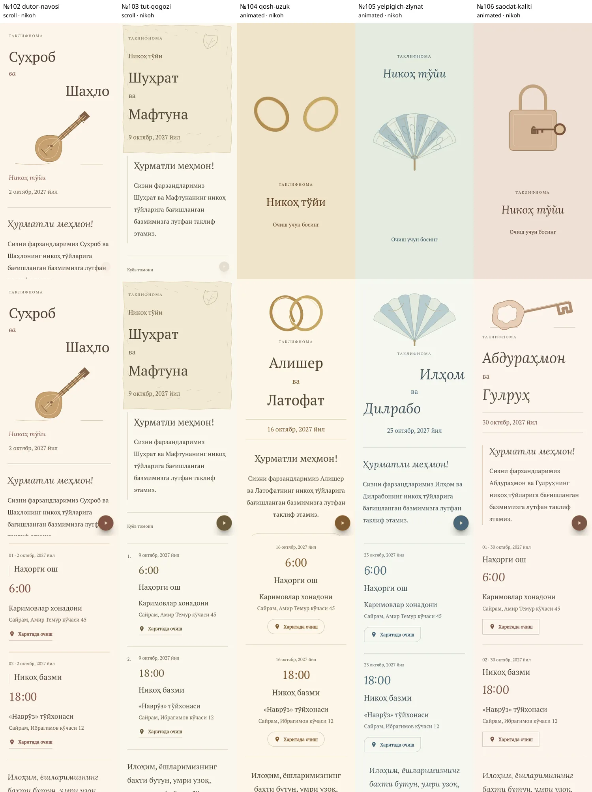

## Воспроизведение

Из корня проекта: `npm run dev -- --webpack --port 3000`, затем `node scripts/audit-designs.mjs`. Используется localhost, разрешённый Next dev; 127.0.0.1 может блокировать гидратацию. Скрипт блокирует внешние запросы браузера и не передаёт токены трекинга. Сырьё сохраняется в игнорируемый screens/design-audit, сжатые доказательства — сюда. Повтор отдельных нестабильных страниц: `node scripts/audit-designs.mjs ipak-romol lola-ehtirom shabnam-visol`; исходные ошибки остаются в priorAttempts. Пересборка листов без браузера: `node scripts/audit-design-sheets.mjs` при наличии сырья. Для новой съёмки обновляйте отчёт и явно указывайте режим шрифтов; не смешивайте снимки разных запусков.
