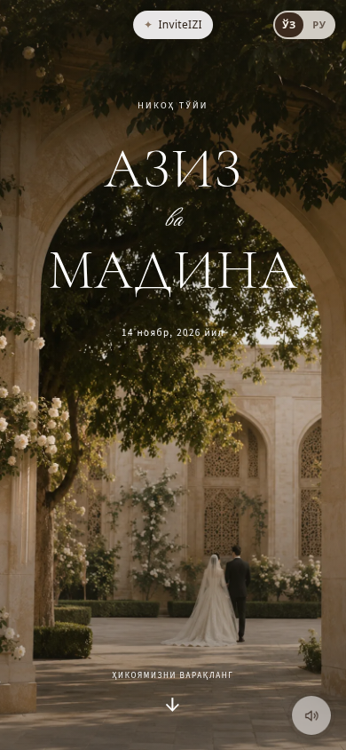
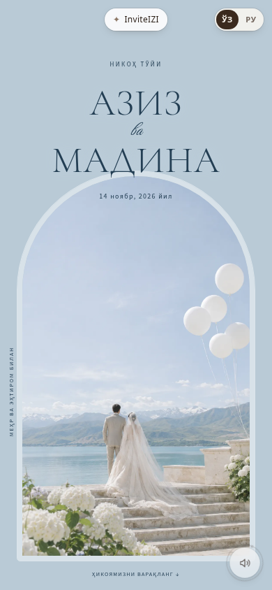
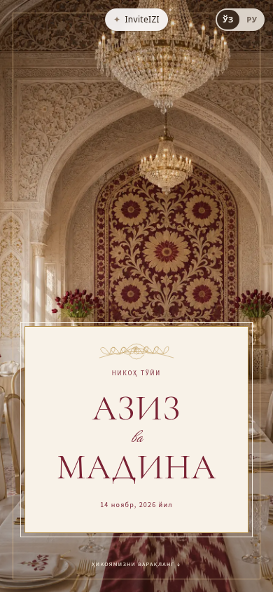

# Текущая работа: четыре новых VIP atelier

[Композиции, фото, анимации и проверки новых вариантов](./atelier.md). Прежние три варианта сохранены; открытие немного замедлено. Новые варианты остаются приватными демо до приёмки.

# VIP InviteIZI · закрытая коллекция

> **Текущая версия — split-v3:** короткое открытие без выдвижения листа, три клиентских фото, адреса без фотографий залов. [Процесс рабочего Preview и проверок](PREVIEW.md). Актуальные HTTPS-ссылки и статус конкретного SHA — в PR #13; артефакты ниже оставлены как история дизайна.

> **Актуальная доработка открытия:** [новые конверты, четыре кадра и видео всех трёх дизайнов](opening-v2.md). Остальная страница сохранена. Результаты открытия ниже относятся к первому проходу.

Три дизайна никоҳ, концепция **10 000 ₸**. Работа выполнена последовательно: VIP-1 → скриншоты/самопроверка/коммит → VIP-2 → скриншоты/самопроверка/коммит → VIP-3. Рабочая цена animated в проекте не изменена, эти концепции не продаются через каталог.

| Дизайн | Маршрут в коде | Композиция | Проверки и видео |
|---|---|---|---|
| Тилла муҳр | `/demo/vip-tilla-muhr` | Кремовый конверт, золотой сургуч, полное фото с именами, журнальная карточка, светлая волнистая программа | [Отчёт](vip-tilla-muhr/README.md) · [Видео](vip-tilla-muhr/opening-and-scroll.webm) |
| Осмон | `/demo/vip-osmon` | Голубой конверт, арка на голубом поле, календарь до приглашения, история рук и шаров, адреса перед программой | [Отчёт](vip-osmon/README.md) · [Видео](vip-osmon/opening-and-scroll.webm) |
| Сўзана | `/demo/vip-suzana` | Бордовый сургуч, видимая вышивка внутри клапана, архитектурная обложка с печатной рамкой, бордовая программа перед календарём, текстильный разворот | [Отчёт](vip-suzana/README.md) · [Видео](vip-suzana/opening-and-scroll.webm) |

Маршруты готовы в ветке. Эта работа сама по себе **не публикует** их на production-домене: новые ID доступны после отдельного preview/deploy, который в рамках задания не выполнялся.

## Посмотреть

| Тилла муҳр | Осмон | Сўзана |
|---|---|---|
|  |  |  |

В каждой папке: конверт; три фазы открытия; все секции; программа и сердце в трёх положениях; 360 и 390 px; дополнительные размеры 320, 375 и 430 px; длинные имена и три события; reduced motion; подтверждение preview RSVP; `verification.json`; `assets.json`; WebM видео.

## Финальные измерения

Средний FPS, production-сборка, Chromium mobile viewport 390×844, CPU 4×:

| Дизайн | Открытие FPS | Программа FPS | p95 кадра, мс (открытие / программа) | Ошибок консоли |
|---|---:|---:|---:|---:|
| Тилла муҳр | 58.45 | 60 | 16.7 / 16.7 | 0 |
| Осмон | 58.85 | 60 | 16.8 / 16.7 | 0 |
| Сўзана | 58.08 | 60 | 16.8 / 16.7 | 0 |

`npm run lint`, `tsc --noEmit`, `npm test`, `next build` прошли. Существующая suite: **83 файла / 1036 тестов пройдены**, 3 файла / 79 тестов штатно пропущены (внешние интеграционные проверки без credentials). Зависимости и конфигурация тестов сохранены. Исходный проект перед работой тоже проходил эти проверки.

## Что общее и что защищено

Новые дизайны используют `useInvitation` и `InvitationShell`: имена и инициалы, даты, события, адреса, ссылки карт, музыку заказа, язык, бренд, подсказку нажатия и RSVP. Время торта, танцев и церемонии не выдумывается: программа отражает только реальные события заказа. Небольшие круглые фото используются как декоративная атмосфера. У зала явно указано, что фото декоративное.

Общие технические элементы лежат внутри новой папки VIP-1, чтобы не менять существующий каркас. Из реестра добавлены только регистрации `design(...)` и необходимые назначения стиля. **ACCEPTED, DISPLAY_PRIORITY, CATALOG_ORDER и PRICES сохранены.** В каталоге по-прежнему 36 принятых дизайнов. Backend, бот, API, lib, Supabase, миграции, env, package.json, lockfile и прежние дизайны не изменены. База не затрагивалась, внешние хранилища не использовались. Merge и production deploy не выполнялись.

До старта открытия декодируются все изображения первых экранов и ожидаются локальные шрифты. Движение — transform/opacity; календарный SVG-контур сердца рисуется stroke-анимацией по заданию. Подсветка пункта программы — opacity отдельной подложки. Scroll-сердце использует `useScroll` → `getPointAtLength` → motion values, без React-перерисовки на каждом кадре. Фотографии WebP, каждый файл ≤250 000 байт; full-screen hero 1170 px, бумага 1024 px. Все три шрифта содержат ў, қ, ғ, ҳ и прописные формы (проверены таблицы cmap).

## Воспроизвести проверку

Используются только существующие npm-зависимости. Понадобятся Chromium и ffmpeg Playwright; например, `npx playwright-core install chromium ffmpeg` устанавливает исполняемые файлы тестовых инструментов и не меняет package.json.

1. `npm ci`, затем `npm run lint`, `npm test`, `npm run build`, `npx tsc --noEmit`.
2. Запустить dev: `npm run dev` (порт 3000). На этом маршруте тестируется существующая preview RSVP без отправки в сеть.
3. Запустить локальную production-сборку: `npm run start -- -p 3001`.
4. `VIP_ORIGIN=http://localhost:3001 VIP_CHECK_ORIGIN=http://localhost:3000 node scripts/vip-shots.mjs`.

`CHROMIUM_PATH` задаёт путь Chromium (по умолчанию `/usr/bin/chromium`). `PLAYWRIGHT_BROWSERS_PATH` при необходимости указывает каталог с установленным ffmpeg. Для одного дизайна передать ID аргументом. Тестовый браузер использует только публичный ключ CA из `NODE_EXTRA_CA_CERTS`, если он настроен средой, и не отключает TLS-проверку целиком. На production dev-маршрут штатно закрыт, поэтому для служебной проверки выделен отдельный dev-origin.

## Честные пределы

- FPS относится к Chromium в этой среде, mobile viewport, 4× CPU throttling. Замер проводится отдельно, без видео/скриншотов и без параллельных тяжёлых проверок. Это не измерение на физическом iPhone.
- Реальный iOS Safari здесь недоступен. CSS учитывает safe-area, `100dvh`, perspective, preserve-3d, backface-visibility и reduced motion; проверка на устройстве остаётся необходимой перед приёмкой.
- Все фотографии сгенерированы по текущему заданию, которое для этой коллекции заменяет прежний запрет AI-фотографий в AGENTS.md. Изображения залов не относятся к реальным адресам. Лиц нет. Мелкие детали взяты из общих исходников и не предназначены для печатного увеличения.
- В стандартном `/demo` исходный образец проекта не содержит rsvpSlug. Полный сценарий формы проверен на существующей dev-странице; в настоящем заказе форму показывает оболочка по rsvpSlug.
- Подсказка руки — штатный TapHint оболочки; она появляется по её существующим правилам. Фотографии flap.webp сохранены и декодируются, но физический клапан собирается из слоёв CSS и фактуры бумаги.
