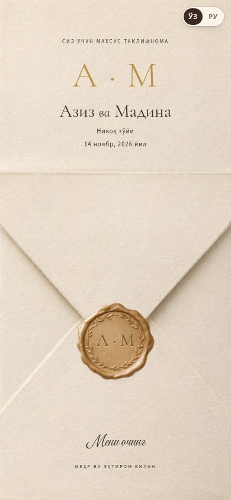
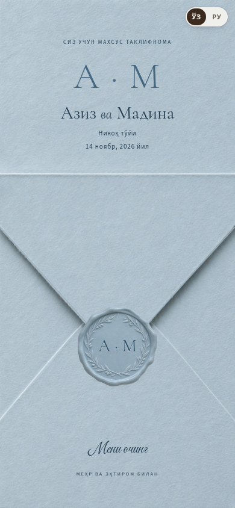
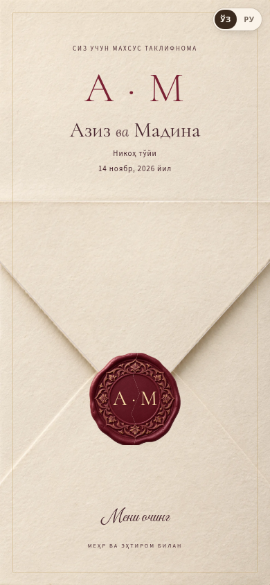

# Доработка первого экрана и открытия · PR #13

Изменены только конверты, их материалы и открытие трёх VIP-дизайнов; отдельно исправлено положение единственного переключателя языка. Существующая композиция, фотографии и их количество, календарь, программа, адреса, RSVP, данные, бот и каталог сохранены.

- Новая фототекстура плотной хлопковой бумаги/картона, реальные складки и мягкие контактные тени; клапан с кромкой, толщиной и изменением освещения во время 3D-поворота.
- Печать увеличена до **34% ширины**; сохранены неровный восковой край, фотографический блик, растительный орнамент и тиснёные инициалы заказа.
- Внутренняя сторона с узором у всех трёх: золото на кремовой бумаге, голубой орнамент, сюзане.
- Последовательное открытие по завершению каждой анимации, без конкурирующих таймеров. Имена появляются целой надписью на прямоугольном листе. Промежуточной треугольной фотографии с «Азиз» больше нет.
- Надпись основной обложки ждёт ухода конверта и затем мягко заменяет надпись на листе; двойных имён в промежуточных кадрах нет. Видео начинается с готового конверта.
- Переключатель языка в DOM один. В VIP он закреплён в верхней части страницы и уходит вместе с шапкой при прокрутке; на фото «Манзил» не накладывается. Общий LangSwitch и другие дизайны не изменены.

## Новые кадры 390 px и видео

| Дизайн | Конверт и 4 кадра | Видео |
|---|---|---|
| Тилла муҳр | [Галерея](vip-tilla-muhr/opening-v2/README.md) | [Открытие](vip-tilla-muhr/opening-v2/opening.webm) |
| Осмон | [Галерея](vip-osmon/opening-v2/README.md) | [Открытие](vip-osmon/opening-v2/opening.webm) |
| Сўзана | [Галерея](vip-suzana/opening-v2/README.md) | [Открытие](vip-suzana/opening-v2/opening.webm) |

| Тилла муҳр | Осмон | Сўзана |
|---|---|---|
|  |  |  |

## Проверки

Production-сборка, Chromium, 390×844, CPU 4×, отдельный замер без видео/скриншотов и параллельных тяжёлых процессов:

| Дизайн | FPS открытия | p95 кадра, мс | Ошибок консоли |
|---|---:|---:|---:|
| Тилла муҳр | 59.2 | 16.7 | 0 |
| Осмон | 59.01 | 16.7 | 0 |
| Сўзана | 59.21 | 16.7 | 0 |

Проверены 320, 360, 375, 390 и 430 px, порядок этапов, клавиатурное открытие и reduced motion. При задержанном фото анимация ожидает decode. Сургуч измерен в браузере: 34% ширины. На всех размерах переключатель языка один и отсутствует в области «Манзил». Линтер, TypeScript, next build прошли; 1036 существующих тестов passed, 79 штатно skipped.

Фотографии изначальной страницы побайтно сверены с состоянием PR до этой правки. Ни одна не заменена и не удалена. Новые WebP материалов — до 250 000 байт, фотография конверта 1170×2532 px, бумага 1024×1024 px. Нет новых npm-пакетов. Сохранено отдельное пользовательское изменение корневого README (9713423). Merge и production deploy не выполнялись.

Запуск: `VIP_ORIGIN=http://localhost:3001 node scripts/vip-shots.mjs --opening-only`. Требования Chromium/ffmpeg и переменные окружения описаны в общем README. Исходные артефакты первого прохода оставлены для сравнения; эта папка описывает актуальное открытие.

Предел проверки: Chromium с мобильным viewport, а не физический iPhone/Safari. Ниже первого экрана UI не изменялся.
